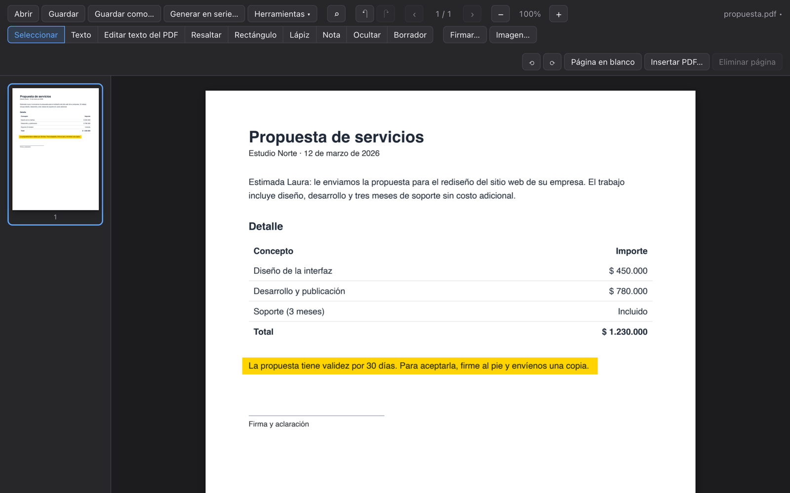

<h1 align="center">Pliego</h1>

Editor de PDF gratuito y de código abierto para Windows y macOS. 
Funciona sin internet: tus documentos nunca salen de tu computadora.

  <a href="https://romanarenas32.github.io/pliego-documents-edit/"><b>Sitio web</b></a> ·
  <a href="https://github.com/RomanArenas32/pliego-documents-edit/releases/latest"><b>Descargar</b></a>

## Qué hace

- **Editar:** corregir el texto original del PDF (con su fuente, tamaño y color) y agregar texto nuevo.
- **Firmar:** firma dibujada o como imagen, e imágenes en cualquier página.
- **Formularios:** rellenar campos de texto, casillas y listas.
- **Revisar:** resaltar, subrayar, tachar, notas adhesivas, rectángulos y lápiz.
- **Ocultar datos de verdad:** lo tapado se borra del archivo, no solo se cubre.
- **Páginas:** unir, rotar, eliminar, extraer, dividir e insertar páginas.
- **Marcas de agua:** encontrarlas y quitarlas de tus documentos, con vista previa.
- **Convertir:** exportar a Word o a imágenes, y crear un PDF desde fotos.
- **Proteger:** contraseña con cifrado AES-256 y reducción de tamaño.
- **En serie:** generar documentos desde una planilla de Excel o CSV, con códigos QR.
- Búsqueda, impresión y deshacer (hasta 100 pasos).

## Desarrollo

Requisitos: [Rust](https://rustup.rs), [Node.js](https://nodejs.org) 22 y [pnpm](https://pnpm.io).

1. Instalar dependencias: `pnpm install`
2. Descargar la biblioteca de pdfium (versión `chromium/7881`) desde
   [pdfium-binaries](https://github.com/bblanchon/pdfium-binaries/releases) y copiarla en
   `src-tauri/pdfium/` (`libpdfium.dylib` en macOS, `pdfium.dll` en Windows).
3. Abrir la app en modo desarrollo: `pnpm tauri dev`
4. Pruebas: `cd src-tauri && cargo test`

Tecnologías: [Tauri 2](https://tauri.app), Rust, TypeScript y [PDFium](https://pdfium.googlesource.com/pdfium).

## Publicar una versión

1. Subir el número de versión en `package.json`, `src-tauri/Cargo.toml` y `src-tauri/tauri.conf.json`.
2. Crear y subir la etiqueta: `git tag v0.2.0 && git push --tags`.
3. GitHub Actions compila los instaladores y los publica en
   [Releases](https://github.com/RomanArenas32/pliego-documents-edit/releases). Los botones de la web
   apuntan siempre a la última versión.

Si cambian las dependencias, regenerar los avisos de licencias de terceros con
`scripts/generate-notices.sh`.

## Licencia

Copyright © 2026 [Veczail Company](https://www.veczail.com).

[GPL-3.0](LICENSE). Pliego incluye software de terceros; sus licencias están en
[THIRD_PARTY_NOTICES.txt](THIRD_PARTY_NOTICES.txt).
